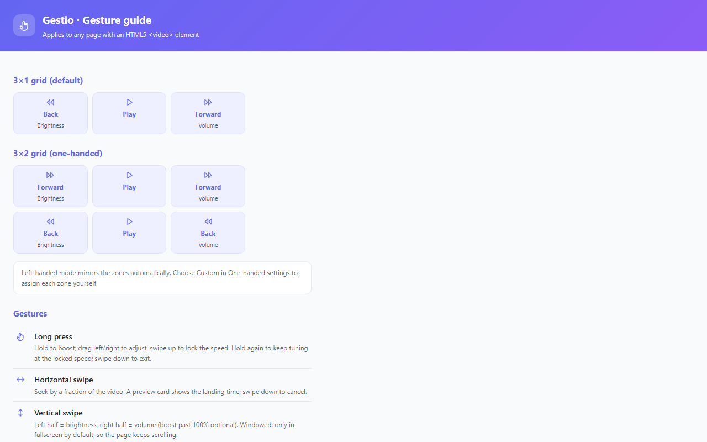

# Gestio — gesture control for web video

[](LICENSE)
[](manifest.json)
[](tests)

**Gestio puts the playback controls back under your thumb.** Swipe, hold and double-tap anywhere on a
video: speed, seek, brightness and volume — no hunting for a 12-pixel play button in a mobile player.

Works with any page that renders an HTML5 `<video>` element. Built for Chromium-based browsers,
with first-class support for **Edge and Chrome on Android**.

> English · [简体中文](README.zh-CN.md)



## Features

| | |
| --- | --- |
| **Long-press speed** | Hold to boost, drag left/right to tune, swipe up to lock. Locked speed is remembered: hold again to keep tuning from there, swipe down to drop back to the pre-lock rate. |
| **Swipe to seek** | Horizontal drag with a preview card showing the landing time. Swipe down to cancel — a warning appears at half the cancel distance. |
| **Vertical swipes** | Left half = brightness, right half = volume, each with its own meter and percentage (brightness left, volume right). Optional Web Audio boost above 100%, with a notch at plain 100%. |
| **Double tap** | Left = back 10 s, centre = play/pause, right = forward 10 s. Repeated taps accumulate (20 s, 30 s, …) when enabled. |
| **Two-finger tap** | Locks brightness (left half) or volume (right half) independently, so a stray swipe cannot move it. |
| **One-handed mode** | Right / left / custom zone mapping, 3×1 or 3×2 grid, adjustable gesture-area height. |
| **A-B loop** | On-screen panel plus keyboard shortcuts (`[` `]` `\` `P` `Alt+L`, all editable). |
| **Lock button** | Full-screen touch guard for kids / pocket mode, with play and skip controls still available. |
| **Alt + scroll** | Step-by-step seeking without moving the pointer over the video. |
| **Per-site rules** | Disable on chosen domains, or block page touch handlers on chosen domains. |

Everything is local: no network requests, no analytics, no accounts.

## Gestures

| Gesture | Action |
| --- | --- |
| Long press | Speed boost; drag to adjust, swipe up to lock, swipe down to exit |
| Horizontal swipe | Seek (preview card, swipe down to cancel) |
| Vertical swipe | Left half brightness, right half volume — windowed playback leaves the swipe to the page by default |
| Two-finger tap | Toggle brightness lock (left) / volume lock (right) |
| Double tap | Back / play-pause / forward |
| Alt + scroll | Seek in steps |
| A-B loop | Panel or `[` `]` `\` `P` `Alt+L` |
| Lock button | Touch guard |

In the default 3×1 grid, the left zone also handles double-tap-to-seek-backward and the right zone
forward; the centre zone toggles playback.

## Install

### From the browser store

- **Edge Add-ons**: _link goes here once published_
- **Chrome Web Store**: not published yet

### From source (developer mode)

```bash
git clone https://github.com/moyisuosheng/gestio.git
```

1. Open `edge://extensions` (or `chrome://extensions`).
2. Turn on **Developer mode**.
3. Choose **Load unpacked** and select the repository root (the folder containing `manifest.json`).

### Sideload a CRX

`pnpm run pack:crx` produces `dist/gestio-<version>.crx`. Drag it onto `edge://extensions`.
On recent Chromium versions self-signed CRX files may be rejected unless the browser policy allows
them — developer mode is the reliable path. See [docs/BUILDING.md](docs/BUILDING.md).

### Android

Edge and Chrome for Android accept extensions from the store, and Chromium 111+ accepts sideloaded
ones in developer mode. Two limitations are the browser's, not the extension's:

- a **downloaded local file** opened in the browser's own player (`content://`) cannot be scripted;
- `file://` pages need file access enabled for extensions.

Play the video from an `http(s)` page instead.

## Development

Requires Node.js 20+ and pnpm (only for tests and packaging; the extension itself has no build step).

```bash
pnpm install         # jsdom, test-only
pnpm test            # 252 unit assertions across 4 files
pnpm run test:browser # needs Chrome/Edge: real page + real pointer events
pnpm run pack        # dist/gestio-<version>.zip  (store upload)
pnpm run preflight   # pre-upload self-check: package, copy, artwork, policy URL
pnpm run pack:crx    # dist/gestio-<version>.crx  (sideload)
pnpm run shots       # regenerate docs/screenshots from the shipped pages
```

`pnpm run pack:crx` signs with `key.pem` in the repository root when present. That key defines the
extension ID, so keep it private and keep it stable, or installs become a second extension instead
of an update. It is gitignored.

### Layout

```
manifest.json          MV3 manifest
background.js          service worker: settings storage, install migrations
content/gesture.js     the gesture engine (pointer + touch), HUD, panels
content/main-world.js  MAIN-world bridge: playbackRate pin, volume relay
content/style.css      minimal injected styles
options.html/js        full settings page (grouped, searchable, i18n)
popup.html/js          quick panel
guide.html/js          gesture cheat sheet
i18n.js                string table (en / zh_CN) + DOM applier
_locales/              manifest strings
settings.json          reference defaults (used by tests)
tests/                 jsdom unit tests + CDP browser tests
scripts/               pack, pack-crx, deterministic zip writer
docs/                  store listing, privacy policy, screenshots
```

The gesture engine is a state machine driven by `pointerdown/move/up` with a parallel `touch*` path
for Android native fullscreen, where pointer events in the video top layer are incomplete. Both feed
the same per-stroke state (`s.axis`, `s.claimed`, `s.seeking`, …); `claimed` — not finger velocity —
decides whether the trailing synthetic click is blocked, which is what keeps single-tap play/pause
feeling native on phones.

## Privacy & permissions

Gestio runs only on pages you open, never sends anything anywhere, and stores settings in
`chrome.storage.local`.

| Permission | Why |
| --- | --- |
| `storage` | Save your settings |
| `activeTab`, `tabs` | Open the options page and read the current tab's URL for the per-site rules |
| `scripting` | Re-inject the gesture script into tabs that were open before install/update |
| `<all_urls>` | The gesture layer has to work on any site that plays video; nothing is read from the page except the `<video>` element geometry |

See [docs/privacy-policy.md](docs/privacy-policy.md).

## License

[MIT](LICENSE).
