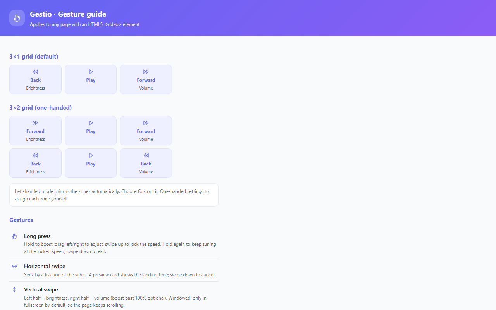

# Gestio — 网页视频手势控制

[](LICENSE)
[](manifest.json)

**把播放控制键还给你的拇指。** 在视频画面上滑、长按、双击，就能调倍速、拖进度、调亮度与音量，
不用再去点手机播放器角落里那个十几像素的小按钮。

任何渲染 HTML5 `<video>` 的网页都能用。为 Chromium 内核浏览器设计，对**安卓版 Edge / Chrome** 做了专门适配。

> [English](README.md) · 简体中文



## 功能

| | |
| --- | --- |
| **长按倍速** | 按住即加速，左右拖动调档，上滑锁定倍速。锁定后再次长按以锁定值为基准继续调，下滑退出回到锁前速率。 |
| **横滑拖进度** | 拖动时弹出预览卡显示落点时间；下滑取消，下滑到一半距离时先给提示。 |
| **竖滑** | 左半屏亮度、右半屏音量，各自一条指示条并显示百分比（亮度在左、音量在右）；音量可选开启超过 100% 的 Web Audio 增强，100% 处有刻度。 |
| **双击** | 左区后退 10 秒、中区播放/暂停、右区前进 10 秒；开启累加后连点即 20 秒、30 秒…… |
| **双指轻点** | 左半屏锁亮度、右半屏锁音量，两边各自独立，锁定后误触不会改动数值。 |
| **单手模式** | 右手 / 左手 / 自定义分区，3×1 或 3×2 网格，手势区域高度可调。 |
| **A-B 循环** | 屏幕上的控制面板，或键盘 `[` `]` `\` `P` `Alt+L`（均可自定义）。 |
| **锁定按钮** | 全屏触摸护盾，防误触，锁定期间仍保留播放与快进快退。 |
| **Alt + 滚轮** | 不用把鼠标移回视频也能逐步跳转。 |
| **按站点规则** | 指定域名禁用扩展，或指定域名拦截页面自身的触摸处理。 |

全部本地运行：不联网、不统计、不需要账号。

## 手势一览

| 手势 | 作用 |
| --- | --- |
| 长按 | 倍速提升；左右拖动调档，上滑锁定，下滑退出 |
| 横滑 | 拖进度（带预览卡，下滑取消） |
| 竖滑 | 左半屏亮度、右半屏音量（未全屏时默认交给页面滚动） |
| 双指轻点 | 切换亮度锁（左）/ 音量锁（右） |
| 双击 | 后退 / 播放暂停 / 前进 |
| Alt + 滚轮 | 逐步跳转 |
| A-B 循环 | 面板或 `[` `]` `\` `P` `Alt+L` |
| 锁定按钮 | 全屏触摸护盾 |

默认 3×1 网格下，左区兼管"双击后退"、右区兼管"双击前进"，中区切换播放。

## 安装

### 从商店安装

- **Edge 加载项商店**：_上架后补充链接_
- **Chrome 应用商店**：暂未上架

### 从源码加载（开发者模式）

```bash
git clone https://github.com/moyisuosheng/gestio.git
```

1. 打开 `edge://extensions`（或 `chrome://extensions`）；
2. 打开「开发人员模式」；
3. 点「加载解压缩的扩展」，选择**仓库根目录**（含 `manifest.json` 的那一层）。

### 侧载 CRX

`pnpm run pack:crx` 会生成 `dist/gestio-<版本>.crx`，拖到 `edge://extensions` 即可。
新版 Chromium 对自签名 CRX 限制较严，除非浏览器策略允许，否则开发者模式是更稳的路径，
详见 [docs/BUILDING.md](docs/BUILDING.md)。

### 安卓

安卓版 Edge / Chrome 可以从商店装扩展，Chromium 111+ 也支持开发者模式侧载。两个限制来自浏览器本身：

- 用浏览器自带播放器打开的**本地已下载视频**（`content://`）无法注入脚本；
- `file://` 页面需要额外开启"允许访问文件网址"。

请从 `http(s)` 页面播放视频。

## 开发

需要 Node.js 20+ 和 pnpm（只用于测试与打包，扩展本身没有构建步骤）。

```bash
pnpm install         # 安装 jsdom（仅测试用）
pnpm test            # 4 个测试文件、252 条断言
pnpm run test:browser # 需要本机 Chrome/Edge：真实页面 + 真实指针事件
pnpm run pack        # dist/gestio-<版本>.zip（商店上传用）
pnpm run preflight   # 上传前自检：包结构、文案字数、素材尺寸、政策页可达
pnpm run pack:crx    # dist/gestio-<版本>.crx（侧载用）
pnpm run shots       # 用真实页面重新生成 docs/screenshots
```

`pnpm run pack:crx` 在仓库根目录存在 `key.pem` 时用它签名。这个私钥决定扩展 ID：**要保密、要保持不变**，
否则覆盖安装会变成"又装了一个新扩展"。它已在 `.gitignore` 中。

### 目录结构

```
manifest.json          MV3 清单
background.js          Service Worker：设置读写、升级迁移
content/gesture.js     手势引擎（pointer + touch）、HUD、面板
content/main-world.js  MAIN world 桥接：倍速 pin、音量转发
content/style.css      注入的最小样式
options.html/js        完整设置页（分组、搜索、中英双语）
popup.html/js          快速设置面板
guide.html/js          手势速查页
i18n.js                文案表（en / zh_CN）与 DOM 应用器
_locales/              清单文案
settings.json          默认值参考（测试读取）
tests/                 jsdom 单元测试 + CDP 浏览器测试
scripts/               打包、CRX、确定性 zip 写入
docs/                  商店文案、隐私政策、截图
```

手势引擎是一台由 `pointerdown/move/up` 驱动的状态机，并为安卓原生全屏另开了一条并行的 `touch*` 路径
（原生全屏时视频顶层的 pointer 事件是不完整的）。两条路径写入同一份笔画状态（`s.axis`、`s.claimed`、
`s.seeking` 等）。判断"是否拦截随后的合成 click"用的是 `claimed` 而不是手指速度——这正是手机上单击
播放/暂停手感正常的原因。

## 隐私与权限

Gestio 只在你打开的页面上运行，不发送任何数据，设置保存在 `chrome.storage.local`。

| 权限 | 用途 |
| --- | --- |
| `storage` | 保存设置 |
| `activeTab`、`tabs` | 打开设置页、读取当前标签页地址以匹配站点规则 |
| `scripting` | 安装/升级后向已打开的标签页补注入脚本 |
| `<all_urls>` | 手势层需要覆盖任意播放视频的网站；除 `<video>` 元素的位置尺寸外不读取页面内容 |

详见 [docs/privacy-policy.md](docs/privacy-policy.md)。

## 许可

[MIT](LICENSE)。
